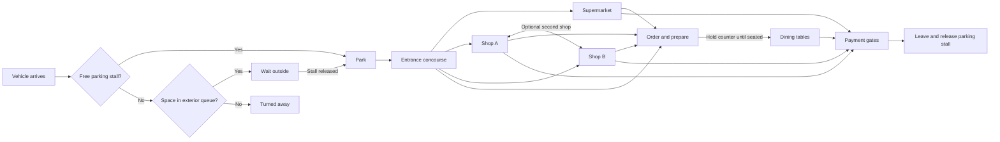
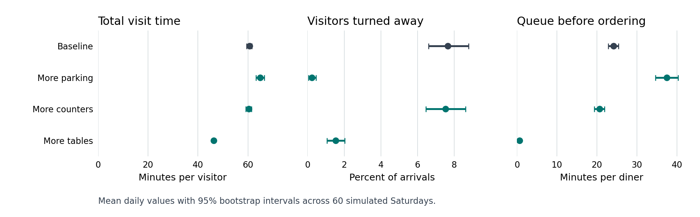

# Lab 6 – Dynamics in a commercial and entertainment complex

**Dining tables limited throughput in the simulated Saturday rush.** With 12 tables, finished orders held 30.97% of all available counter-minutes during opening hours. Increasing seating to 24 tables reduced that share to 0.16%. Visitors then left sooner, released parking stalls sooner, and waited less outside, even though parking capacity stayed at 72 stalls. These estimates use illustrative demand and service times.

## Reproduce the experiment

From the repository root with Python 3.10 or newer, run the experiment and the Lab 6 tests.

```sh
python3 -B -m lab6 --days 60 --seed 2026
python3 -B -m unittest -v lab6.test_model
```

The simulator and the statistical analysis use the standard library. To regenerate the figure with Matplotlib installed, add `--plot lab6/scenario-comparison.png` to the first command. The full results table includes a confidence interval for every reported KPI. [Simulation code](model.py) · [Experiment code](__main__.py) · [Full results](results.md)

## Visitors, paths and capacity

One entity is one visitor arriving in one vehicle. An admitted visitor holds one parking stall from entry through payment at the exit. One diner occupies one whole table. A shop slot represents space for one active shopper. A counter or gate serves one visitor at a time. Interior queues and concourse walking have unrestricted capacity.



The day starts empty at noon. Independent Poisson arrivals have constant rates within each clock hour. From noon to 18:00 the six rates are **35, 60, 90, 105, 75 and 45 visitors/hour**, giving 410 expected arrivals. The generator restarts the exponential arrival clock at each rate boundary. At 18:00 arrivals stop. Everyone already inside or in the exterior queue can finish.

| Stage | Baseline capacity | Duration or operating rule |
| --- | ---: | --- |
| Parking and exterior | 72 stalls, 12 waiting vehicles | If all stalls are occupied, join the exterior FIFO. Leave immediately if it is also full. |
| Concourse | Unrestricted | Walk before each store, counter or gate visit. Walking time is triangular (1, 2, 5) minutes. |
| Supermarket | 20 shopping slots | Shopping time is triangular (15, 25, 45) minutes. |
| Shops A and B | 12 slots each | Time at each shop is triangular (10, 18, 32) minutes. |
| Food ordering | 4 counters | Preparation takes triangular (2, 4, 7) minutes. A finished order holds its counter until a table is available. |
| Dining | 12 tables | The meal takes triangular (14, 24, 37) minutes. The longest-waiting finished order gets the next table. |
| Exit and payment | 2 gates | Payment takes triangular (0.4, 0.8, 1.8) minutes. Completion releases the vehicle's parking stall. |

All triangular triples give minimum, mode and maximum. On entry, 40% of visitors choose the supermarket, 35% explore the gallery and 25% go directly to eat. A supermarket visitor has a 20% chance of dining afterward. An explorer chooses the first shop with equal probability and visits the other shop with probability 65%. The probability of dining is 20% after one shop and 50% after two. Each visitor ultimately joins the gate queue.

The simulator keeps an event calendar, occupied counts, FIFO queues and each visitor's position in their itinerary. A dining completion transfers a free table to the first blocked customer at that instant, releases that customer's counter, and allows the next order to start. This is *blocking after service*. Processing simultaneous internal events in insertion order and handling them before new external arrivals gives a reproducible tie rule. [Event and transfer logic](model.py)

## What the KPIs measure

| Metric | Observation and denominator |
| --- | --- |
| Sojourn | Elapsed minutes from first arrival outside to gate completion, averaged across completed visitors. This includes exterior waiting, walking, activity, dining and payment. |
| Outside, ordering and table waits | Outside wait per admitted visitor. Pre-order queue time and post-order wait while holding a counter per diner. All three means include zero waits. |
| Admission loss and throughput | Fraction of offered arrivals turned away and number of visits completed, including completions after closing. |
| Resource utilization | For capacity $c$ and occupancy $b(t)$, $\int_0^T b(t)\,dt/(cT)$ with $T=360$ minutes. Each store, the lot, counters, tables and gates have a separate measure. Counter occupancy includes preparation and blocking. |
| Parking and dining saturation | Fraction of opening time at full capacity, $\int_0^T \mathbf{1}\{b(t)=c\}\,dt/T$. A separate arrival measure records the fraction of offered vehicles finding parking full. An order-completion measure records the fraction of diners finding all tables occupied. |
| Counter blocking | Integral of the number of finished orders holding counters during opening hours, divided by installed counter-minutes. It measures how much capacity seating takes away from order preparation. |

Time-weighted metrics describe a uniformly chosen instant during opening hours. Visitor-based metrics follow the day's entire arrival cohort through its final departure. At baseline, parking was full for 40.29% of opening time, and 46.66% of arriving vehicles saw a full lot. The afternoon peak gives busy periods more weight in the arrival-based figure.

## Capacity experiments

Each alternative changes one baseline input. Parking expands from 72 to 108 stalls, ordering from 4 to 6 counters, or dining from 12 to 24 tables. Each of 60 independently generated days supplies the same arrivals, routes and individual durations to all four scenarios. Pairing the demand this way makes it possible to attribute within-day differences to capacity. Admission decisions can still change which visitors complete their visits.



| Change | Completed visitors/day | Change in total sojourn, minutes per completed visitor | Change in arrivals turned away, percentage points |
| --- | ---: | ---: | ---: |
| Baseline | 379.92 [375.65, 384.07] | Reference mean 60.59 [59.50, 61.60] | Reference loss 7.66% [6.59, 8.78] |
| Add 36 parking stalls | 410.93 [406.55, 415.48] | +4.33 [3.52, 5.16] | −7.43 [−8.44, −6.44] |
| Add 2 ordering counters | 380.47 [376.30, 384.55] | −0.26 [−0.50, −0.02] | −0.13 [−0.27, 0.01] |
| Add 12 dining tables | 405.42 [401.70, 409.20] | −14.26 [−15.10, −13.32] | −6.13 [−6.99, −5.25] |

More parking gave the lowest rejection rate. The larger admitted population then reached the same food court, where the mean queue before ordering grew by 13.27 minutes per diner [11.48, 15.02]. More counters moved some waiting past order completion. Diners spent 3.51 fewer minutes waiting to order [3.21, 3.82] and 3.00 more minutes holding a counter for a table [2.94, 3.05]. The interval for the change in parking losses with extra counters includes zero.

Extra seating produced the largest reduction in visit time among the tested changes. The baseline 12 tables can finish about 28.8 meals/hour under continuous occupation, since a meal averages 25 minutes. The four counters can prepare about 55.4 orders/hour while unblocked. About 46.8% of offered visitors plan to dine. At the peak arrival rate this corresponds to about 49 eventual diners per hour of arrivals, with shopping and admission shifting the times they actually reach the counters. The capacity imbalance explains why seating freed counters and shortened the upstream queue. [All estimates and paired changes](results.md)

**Confidence intervals.** Each entry estimates a mean daily KPI. Each day has equal weight, including for daily proportions and mean waits. Brackets give pointwise 95% percentile bootstrap intervals from 2,000 resamples of whole days. Changes use the within-day scenario differences before resampling. A day with no eligible visitors has an undefined visitor-based mean, which the analysis omits for that metric. All reported experiment days had arrivals, completed visits and diners. The intervals quantify simulation sampling error under the chosen inputs. Field data would be needed to estimate uncertainty in the arrival rates, routes and durations themselves.

## Model validation

- A hand-worked example sends three diners to one counter and one table at minute zero. Each order takes one minute, each meal five, and payment one. Seating begins at minutes 1, 6 and 11. Departures occur at 7, 12 and 17. Over a ten-minute observation window the table is full for nine minutes, the counter is blocked for seven, and mean completed sojourn is 12 minutes. The regression test checks all three results.
- An exterior-queue example checks loss, parking held through payment and departures after closing. A separate case checks an arrival exactly when a gate releases a stall. Another verifies FIFO table transfers when several finished orders occupy counters.
- With more capacity at every station than there are visitors, the simulated mean sojourn agrees with the independent sum of planned walking, activity, meal and payment times. The arrival test compares 300 days of hourly counts with Poisson expectations, including hours with zero demand. The main experiment averaged 411.98 arrivals/day [407.17, 417.00], consistent with its input expectation of 410.
- A one-stall benchmark admits Poisson arrivals directly to exponential payment and turns away arrivals who find the stall occupied. Its exact probability of being full at time $t$ from an empty start is $\lambda(1-e^{-(\lambda+\mu)t})/(\lambda+\mu)$. At $\lambda=0.4$ and $\mu=0.6$ per minute, the exact mean fraction full over one hour is 39.33%. A regression test compares 240 simulated hours to this transient two-state CTMC prediction using replication-level standard errors.
- Each run checks occupancy bounds, that every blocked diner holds a counter, that all queues drain, and that offered arrivals equal departures plus losses. [Executable validation suite](test_model.py)

## When a CTMC description works

A time-homogeneous continuous-time Markov chain requires the current state to determine the distribution of the next state and the waiting time to that transition. Consider an idealization with constant Poisson arrivals of rate $\lambda$, independent exponential activity times of rate $\mu_i$ per active server, and immediate transfers. At each completion a visitor chooses the next station with fixed probabilities $p_{ij}$. An exponential walking stage can also be included explicitly. Any decision that depends on visitor class requires that class to appear in the state.

A sufficient discrete state records the external queue, parking occupancy, queues and active services at each station, occupied tables, and the number of counters blocked after preparation. With multiple classes and FIFO service, the ordered class labels of queues and blocked customers may matter as well. Parking is a resource held across stages, so the number of occupied stalls equals the number of admitted visitors still in the system. Feasible states satisfy this constraint.

For example, if $a_i$ identical shoppers are active at store $i$, the transition completing a shopping visit and routing to $j$ has rate $a_i\mu_i p_{ij}$. With $a_f$ orders in preparation, orders finish at rate $a_f\mu_f$. If all tables are occupied, the transition converts a preparing counter into a blocked one. For $d$ occupied tables, meals finish at rate $d\mu_d$. With a blocked diner present, that transition immediately refills the table, releases a counter and can start the next order. Gate completion similarly releases a stall and can admit the head of the exterior queue. Arrivals occur at rate $\lambda$. A lost arrival leaves the occupancy state unchanged and can be counted separately. These rules define off-diagonal transition rates, with each diagonal equal to the negative sum of the outgoing rates.

The full-table rule **can be Markovian**. Keeping only the number of occupied counters loses essential state. Four occupied counters might be preparing four orders, or all four might be holding finished orders. The next preparation-completion rate differs in those two cases. Recording active and blocked counters resolves that ambiguity under exponential clocks. Blocking, simultaneous table transfers and holding parking across stations also couple the resources, so the usual independent-node Jackson network formulas do not apply.

The simulated afternoon departs from the homogeneous CTMC idealization in three ways.

1. **Elapsed activity time.** For duration $S$ with survival function $\bar F$, the chance of another $s$ minutes given elapsed age $a$ is $\bar F(a+s)/\bar F(a)$. A triangular meal near its upper limit has a different residual duration from a meal just begun. Identical occupancy counts therefore conceal different next-event distributions. Ages or scheduled completion times restore the missing information, yielding a model with continuous state. Discrete phase-type stages could approximate these durations in a larger CTMC.
2. **Visit history.** A gallery shopper finishing a second shop has a different probability of dining from a shopper leaving after one. A single gallery count loses that distinction. A finite itinerary phase or class label can encode this particular history in an enlarged chain. Elapsed visit time or a continuous personal time budget would require still more state.
3. **Clock time.** At the same occupancy, the next arrival is more likely in a short interval during the 105/hour peak than during the 35/hour opening hour. With otherwise Markovian assumptions one can use a time-inhomogeneous generator $Q(t)$ and solve transient equations across hourly boundaries. A stationary equilibrium calculation would miss the buildup and drain of this finite afternoon.

Discrete-event simulation keeps the clock, remaining itinerary and individual completion events directly. It supports the blocking discipline and transient measurements without enumerating a state space of queue orders, route phases and residual times. The experiment assumes an empty mall at noon, one shopper per car, a whole table per diner, fixed itineraries and no abandonment after joining a queue. Group arrivals, table sharing, impatience and visitors changing plans when they see a long line could change the size or location of the bottleneck.
